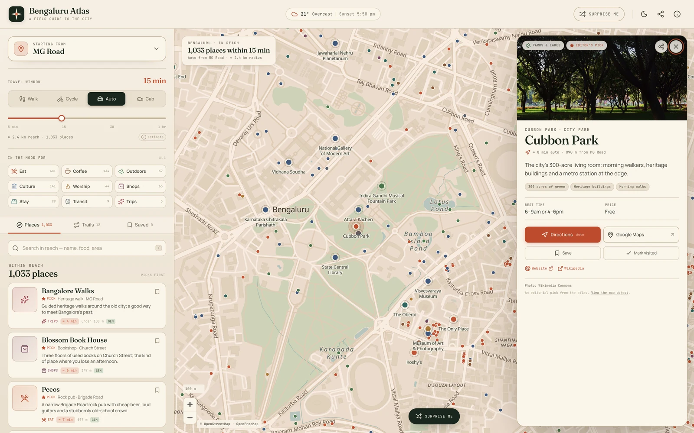
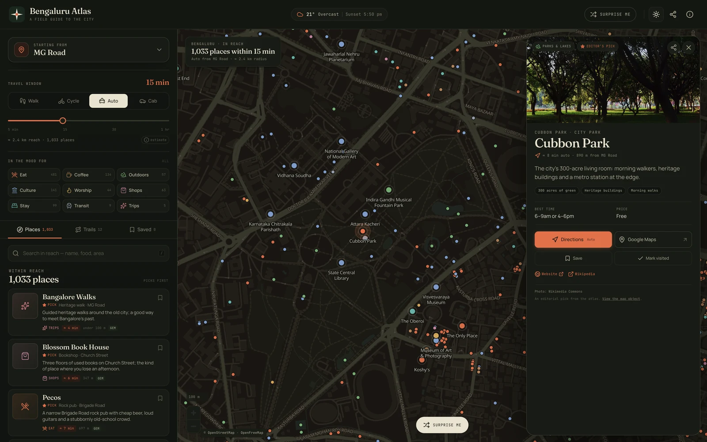

  
  <h1>Bengaluru Atlas</h1>
  
<em>A field guide to the city, sorted by how far you’ll actually go.</em>

  

    
    
    
    
    
  

  
<strong>Bengaluru, inside out.</strong> Pick a corner. Pick a mood. Pick how far you’ll go. 
  Then let the map do the arguing.

 

MG Road · 20 minutes by auto · 800+ places in reach · 13 corridors of live traffic.

 

<table>
<tr>
<td align="center" width="33%"><h3>Pick a corner</h3>
53 neighbourhoods, from Chickpet to Whitefield. Or drop a pin anywhere.
</td>
<td align="center" width="33%"><h3>Name a mood</h3>
37 moods — tiffin, Chinese, lakes, bookshops, temples, bars, breweries, sunsets, stays.
</td>
<td align="center" width="33%"><h3>Set a window</h3>
Walk, cycle, auto or cab. Five minutes to an hour, with live traffic on the roads.
</td>
</tr>
</table>

 

  <h3>One dial. The whole city.</h3>
  Five minutes to sixty. The circle grows, the list follows — and the clock is traffic-aware.

 
 

<table>
<tr>
<td width="50%">
  
</td>
<td width="50%">
  
</td>
</tr>
<tr>
<td align="center"><strong>Dark mode, drawn —</strong> not inverted. A second hand-tuned map style.</td>
<td align="center"><strong>206 trails.</strong> City walks, food crawls, temple runs and day trips — searchable, filterable, and fitted to the map.</td>
</tr>
</table>

 

Church Street · 30 minutes · filter coffee only · ordered by what’s worth the trip.

 
 

  <h3>And it fits in a pocket.</h3>
  Full map, full list, full detail sheet. Nothing watered down.

  
  
  

 

<table align="center">
<thead>
<tr>
  <th align="center">9,362</th>
  <th align="center">201</th>
  <th align="center">53</th>
  <th align="center">206</th>
  <th align="center">0</th>
</tr>
</thead>
<tbody>
<tr>
  <td align="center">places mapped</td>
  <td align="center">editorial picks</td>
  <td align="center">neighbourhoods</td>
  <td align="center">walks &amp; day trips</td>
  <td align="center">API keys</td>
</tr>
</tbody>
</table>

 

> **The honest bit.** The first cards use real road routes from OSRM, adjusted by live readings from 13 instrumented Bengaluru corridors. The rest are modelled from the same speeds, with a baked 24-hour profile when GitHub is unreachable. Traffic updates every ten minutes; every listing opens Google Maps for turn-by-turn.

<strong>Saved &amp; visited</strong> stays in your browser · <strong>shareable links</strong> remember the whole view · <strong>37 moods</strong> · <strong>206 trails</strong> · <strong>live traffic</strong> · <strong>follows your device theme</strong> · <strong>installable</strong> · <strong>no accounts</strong> · <strong>no tracking</strong> · <strong>no keys</strong>

 

  <h3>Built with</h3>
  
React 19 · TypeScript · Vite · MapLibre GL · OpenFreeMap 
  Self-hosted Fraunces, Manrope and JetBrains Mono · a warm, hand-recoloured paper-and-ink basemap

 

<table>
<tr>
<td width="50%" valign="top">

<strong>Run it</strong>

<pre><code>cd app
npm install
npm run dev
npm run build   # → ../docs, ready for Pages</code></pre>

</td>
<td width="50%" valign="top">

<strong>The data</strong>

9,362 OpenStreetMap places, cleaned and categorised. 201 editorial picks with best times and a point of view; 188 places carry an openly licensed photograph, and the rest get a designed cover. Traffic is modelled from 13 instrumented corridors; live readings come from the <a href="https://github.com/thecont1/traffic-monitor-lizard">traffic-monitor-lizard</a> dataset. 206 trails are assembled from curated anchors, and every stop links back to the atlas. Trail stops and area notes live in <a href="./data/"><code>data/</code></a>; the build scripts are in <a href="./scripts/"><code>scripts/</code></a>.

</td>
</tr>
</table>

  Map data © OpenStreetMap contributors (ODbL) · styles and tiles by <a href="https://openfreemap.org">OpenFreeMap</a> · routing by <a href="https://routing.openstreetmap.de">OSRM / OpenStreetMap.de</a> · photographs from Wikimedia Commons · weather by <a href="https://open-meteo.com">Open-Meteo</a>.
   
  Made for Bengaluru. <a href="https://abhinav-prabhakar.github.io/BengaluruAtlas/">Open the atlas →</a> · <a href="./PLAN.md">the original field plan</a>

