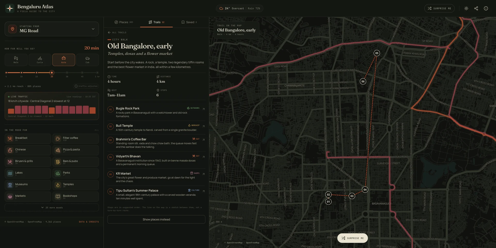
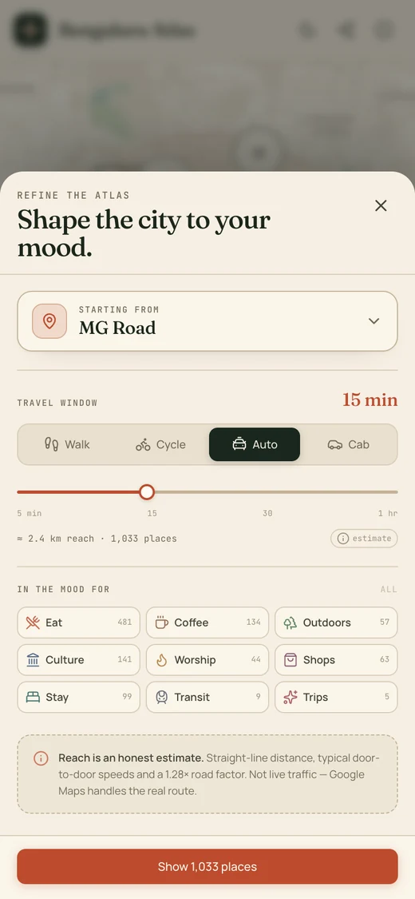

  
  <h1>Bengaluru Atlas</h1>
  
<em>A field guide to the city, sorted by how far you’ll actually go.</em>

  

    
    
    
    
    
  

  
<strong>Bengaluru, inside out.</strong> Pick a corner. Pick a mood. Pick how far you’ll go. 
  Then let the map do the arguing.

 

MG Road → Cubbon Park · 8 minutes by auto · one editorial pick out of 109.

 

<table>
<tr>
<td align="center" width="33%"><h3>Pick a corner</h3>
53 neighbourhoods, from Chickpet to Whitefield. Or drop a pin anywhere.
</td>
<td align="center" width="33%"><h3>Name a mood</h3>
Eat, coffee, parks, temples, bookshops, bars, museums, markets, transit, stays.
</td>
<td align="center" width="33%"><h3>Set a window</h3>
Walk, cycle, auto or cab. Five minutes to an hour. Watch the city redraw itself.
</td>
</tr>
</table>

 

  <h3>One dial. The whole city.</h3>
  Fifteen minutes to sixty. The circle grows, the list follows.

 
 

<table>
<tr>
<td width="50%">
  
</td>
<td width="50%">
  
</td>
</tr>
<tr>
<td align="center"><strong>Dark mode, drawn —</strong> not inverted. A second hand-tuned map style.</td>
<td align="center"><strong>Twelve trails.</strong> Eight city walks, four day trips, every stop linked.</td>
</tr>
</table>

 

Church Street · 30 minutes · eating only · 1,796 places, ordered by what’s worth the trip.

 
 

  <h3>And it fits in a pocket.</h3>
  Full map, full list, full detail sheet. Nothing watered down.

  
  
  

 

<table align="center">
<thead>
<tr>
  <th align="center">10,143</th>
  <th align="center">109</th>
  <th align="center">53</th>
  <th align="center">12</th>
  <th align="center">0</th>
</tr>
</thead>
<tbody>
<tr>
  <td align="center">places mapped</td>
  <td align="center">editorial picks</td>
  <td align="center">neighbourhoods</td>
  <td align="center">walks &amp; day trips</td>
  <td align="center">API keys</td>
</tr>
</tbody>
</table>

 

> **The honest bit.** Travel times are estimates — straight-line distance, typical door-to-door speeds, a 1.28× road factor. No live traffic, no pretend precision. Every listing opens in Google Maps, where the real routing and the “start directions” button live.

<strong>Saved &amp; visited</strong> stays in your browser · <strong>shareable links</strong> remember the whole view · <strong>installable</strong> · <strong>no accounts</strong> · <strong>no tracking</strong> · <strong>no keys</strong>

 

  <h3>Built with</h3>
  
React 19 · TypeScript · Vite · MapLibre GL · OpenFreeMap 
  Self-hosted Fraunces, Manrope and JetBrains Mono · a warm, hand-recoloured paper-and-ink basemap

 

<table>
<tr>
<td width="50%" valign="top">

<strong>Run it</strong>

<pre><code>cd app
npm install
npm run dev
npm run build   # → ../docs, ready for Pages</code></pre>

</td>
<td width="50%" valign="top">

<strong>The data</strong>

10,143 OpenStreetMap places, cleaned and categorised. 109 editorial picks with photographs, best times and a point of view. Trail stops and area notes live in <a href="./data/"><code>data/</code></a>. The build scripts are in <a href="./scripts/"><code>scripts/</code></a>.

</td>
</tr>
</table>

  Map data © OpenStreetMap contributors (ODbL) · styles and tiles by <a href="https://openfreemap.org">OpenFreeMap</a> · photographs from Wikimedia Commons · weather by <a href="https://open-meteo.com">Open-Meteo</a>.
   
  Made for Bengaluru. <a href="https://abhinav-prabhakar.github.io/BengaluruAtlas/">Open the atlas →</a> · <a href="./PLAN.md">the original field plan</a>

