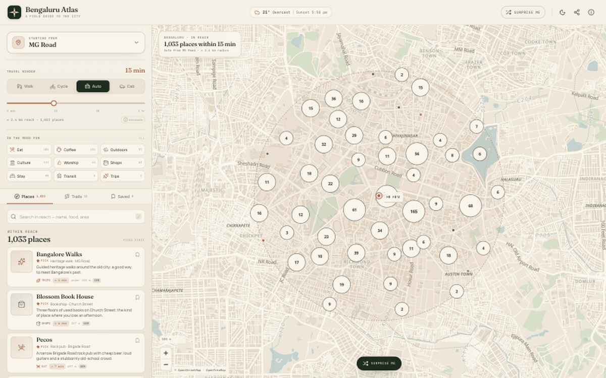
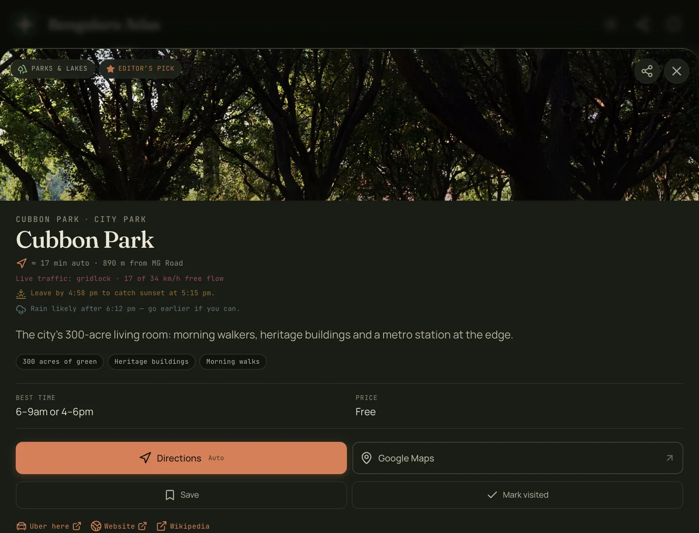
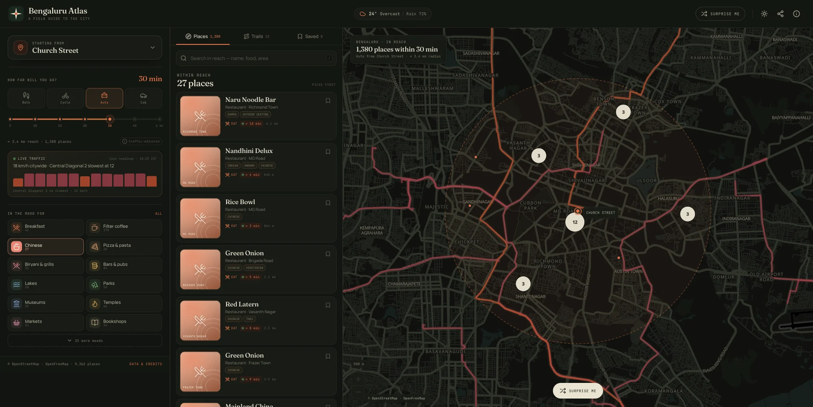
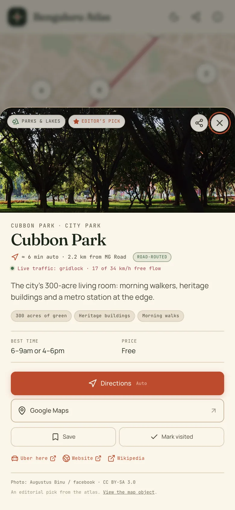
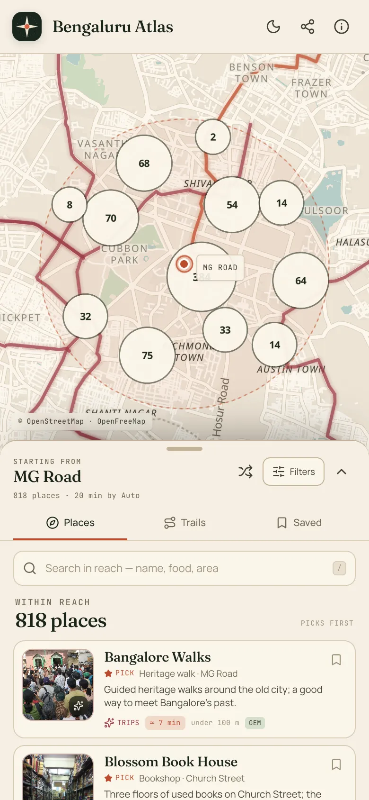
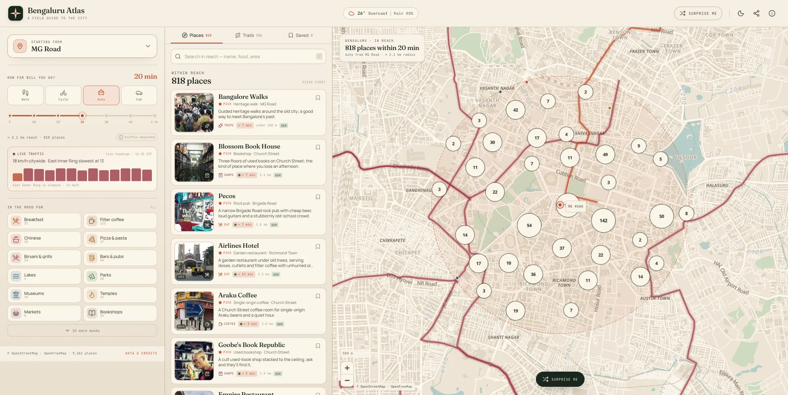

<div align="center">
  
  <h1>Bengaluru Atlas</h1>
  <p><em>9,362 places. 206 trails. One travel-time dial.</em></p>

  <p>
    <a href="https://abhinav-prabhakar.github.io/BengaluruAtlas/"></a>
    <a href="https://github.com/Abhinav-Prabhakar/BengaluruAtlas"></a>
    
    
    
  </p>

  <p>
    
    
    
    
    
  </p>

  <p>
    
    
    
    
    
    
  </p>

  <br/>

  <a href="https://abhinav-prabhakar.github.io/BengaluruAtlas/">
    
  </a>

  <sub>MG Road · 20 minutes by auto · the list follows the road, not the radius.</sub>
</div>

<br/>

<div align="center">
  <h3>One dial. The whole city.</h3>
  <sub>Five minutes to sixty. The circle grows, the list reorders, the clock does the arguing.</sub>
</div>

<p align="center">
  <a href="https://abhinav-prabhakar.github.io/BengaluruAtlas/">
    
  </a>
</p>

<br/>

<table>
<tr>
<td width="50%">
  
</td>
<td width="50%">
  
</td>
</tr>
<tr>
<td align="center"><sub><strong>Dark mode, drawn —</strong> a second hand-tuned map style.</sub></td>
<td align="center"><sub><strong>Time-aware details —</strong> leave by sunset; rain later stays out of the order.</sub></td>
</tr>
<tr>
<td width="50%">
  
</td>
<td width="50%">
  
</td>
</tr>
<tr>
<td align="center"><sub><strong>206 trails.</strong> Walks, crawls, temple runs and day trips.</sub></td>
<td align="center"><sub><strong>Church Street · 30 minutes ·</strong> filter coffee only.</sub></td>
</tr>
</table>

<br/>

<div align="center">
  <h3>And it fits in a pocket.</h3>
  <sub>Full map, full list, full detail sheet. Installable, offline-ready, no app store.</sub>
</div>

<p align="center">
  
  
  
  
</p>

<br/>

<a href="https://abhinav-prabhakar.github.io/BengaluruAtlas/">
  
</a>

<div align="center"><sub><strong>Installable PWA.</strong> Same map, same list, same detail sheet — with an offline shell.</sub></div>

<br/>

<table align="center">
<thead>
<tr>
  <th align="center">9,362</th>
  <th align="center">201</th>
  <th align="center">53</th>
  <th align="center">206</th>
  <th align="center">0</th>
</tr>
</thead>
<tbody>
<tr>
  <td align="center">places mapped</td>
  <td align="center">editorial picks</td>
  <td align="center">neighbourhoods</td>
  <td align="center">walks &amp; day trips</td>
  <td align="center">API keys</td>
</tr>
</tbody>
</table>

<br/>

<details>
<summary><strong>The honest bit</strong></summary>

<p>The first cards use real road routes from OSRM, adjusted by live readings from 13 instrumented Bengaluru corridors; the rest are modelled from the same speeds. Ordering leans on travel time, editorial picks, the hour, golden light, and rain that is actually falling or close — a shower four hours away leaves the list alone. Opening hours are checked against the moment you arrive, road times are cached by neighbourhood, and a rate limit is met with quiet reuse instead of retries.</p>

</details>

<details>
<summary><strong>Run it</strong></summary>

```bash
cd app
npm install
npm run dev
npm run build   # → ../docs, ready for Pages
```

</details>

<details>
<summary><strong>The data</strong></summary>

<p>9,362 OpenStreetMap places, 201 editorial picks, 53 neighbourhoods, 206 trails, 188 openly licensed photographs, and 13 instrumented traffic corridors. Route times from OSRM / OpenStreetMap.de. Weather from Open-Meteo. No accounts, no tracking, no keys.</p>

</details>

<div align="center">
  <sub>Map data © OpenStreetMap contributors (ODbL) · styles and tiles by <a href="https://openfreemap.org">OpenFreeMap</a> · routing by <a href="https://routing.openstreetmap.de">OSRM / OpenStreetMap.de</a> · photographs from Wikimedia Commons · weather by <a href="https://open-meteo.com">Open-Meteo</a>.</sub>
  <br/>
  <sub>Made for Bengaluru. <a href="https://abhinav-prabhakar.github.io/BengaluruAtlas/">Open the atlas →</a> · <a href="./PLAN.md">the original field plan</a></sub>
</div>
